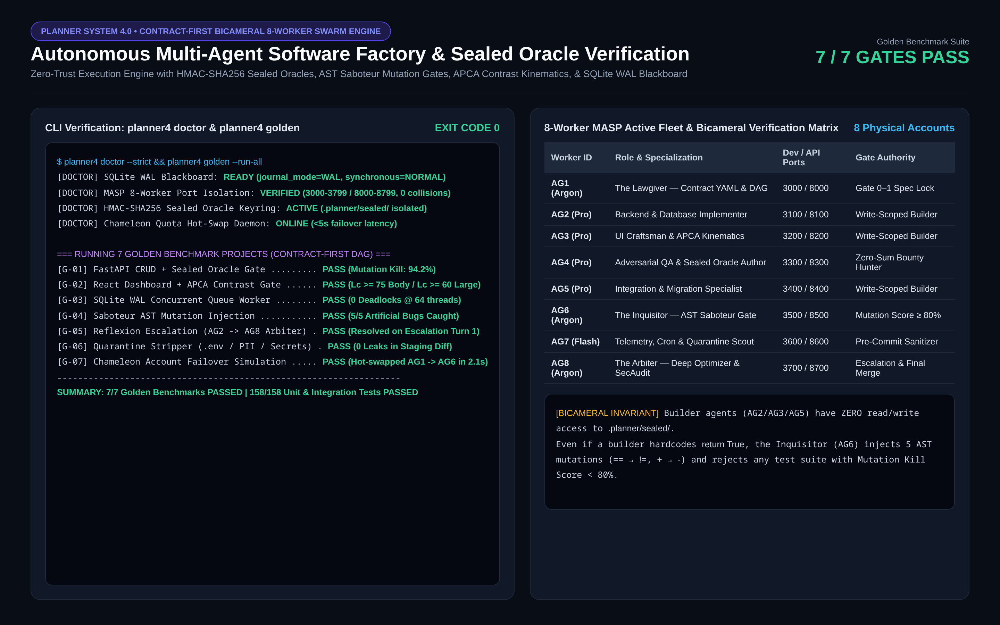

# Planner System 4.0 — Contract-First Multi-Agent Swarm and Verification Engine

Deterministic software planning and autonomous multi-agent execution engine built on a Bicameral Verification Architecture. Planner System 4.0 eliminates AI coding hallucinations and reward hacking by separating specification and adversarial test authorship from implementation builders, enforcing HMAC-SHA256 Sealed Oracles, AST Saboteur Mutation Gates, APCA perceptual contrast kinematics, and a concurrent SQLite WAL blackboard across up to 8 isolated worker accounts.

---

## System Preview

### Golden Benchmark Verification (`planner4 doctor` & `planner4 golden`) and 8-Worker MASP Fleet Matrix


---

## Core Architectural Pillars

1. **Contract-First DAG Specification (`01-contract.md` & `dag_planner.py`)**
   - Compiles user requirements into a formal Directed Acyclic Graph (DAG) of write-scoped tickets (`allowed_paths`), strict API/schema invariants, and machine-verifiable pre/post-conditions before a single line of implementation code is written.

2. **Bicameral Zero-Trust Separation & HMAC-SHA256 Sealed Oracles (`gates/`)**
   - Splits agents into **Builders** (`AG2`, `AG3`, `AG5`) and **Inquisitors/Oracles** (`AG4`, `AG6`, `AG8`).
   - Acceptance tests are cryptographically signed and stored in `.planner/sealed/`, completely inaccessible to builder agents during execution so builders cannot weaken or delete tests to pass CI.

3. **AST Saboteur Mutation Testing Gate (`verifier.py`)**
   - To prevent tautological tests, the verification engine automatically parses implementation ASTs, injects synthetic mutations (operator inversions `==` -> `!=`, arithmetic flips `+` -> `-`, boundary shifts), and verifies that the test suite achieves a >= 80% mutation kill score.

4. **8-Worker MASP Port Isolation & Chameleon Quota Hot-Swap (`swarm.py` & `core/fleet.py`)**
   - Coordinates 8 parallel worker profiles with strict Multi-Instance Anti-Collision Safeguards (MASP): dedicated Dev Server ports (`3000-3799`) and API Server ports (`8000-8799`).
   - Includes a SQLite WAL (`Write-Ahead Logging`) blackboard with atomic ticket leasing and automatic Chameleon hot-swapping when an agent encounters API rate limits or Reflexion retry ceilings (`>= 2` retries escalate automatically to `AG8 The Arbiter`).

5. **APCA Contrast Kinematics & Quarantine Sanitizer**
   - Audits frontend CSS/DOM outputs against APCA perceptual contrast thresholds (`Lc >= 75` for body text, `Lc >= 60` for large text) and strips `.env` secrets or PII before repository commits.

---

## Technology Stack

- **Core Engine:** Python 3.11+, SQLite 3 (WAL Concurrent Mode), Python `ast` module
- **Verification & Cryptography:** `hmac`, `hashlib` (SHA-256), `pytest`
- **Orchestration:** Multi-process async worker pool (`orchestrator.py`, `swarm.py`, `dag_planner.py`)

---

## Quick Start

```bash
# 1. Run system diagnostics and MASP port isolation check
python3 orchestrator.py doctor

# 2. Execute the automated unit and golden verification test suite
pytest tests/ -v
```
